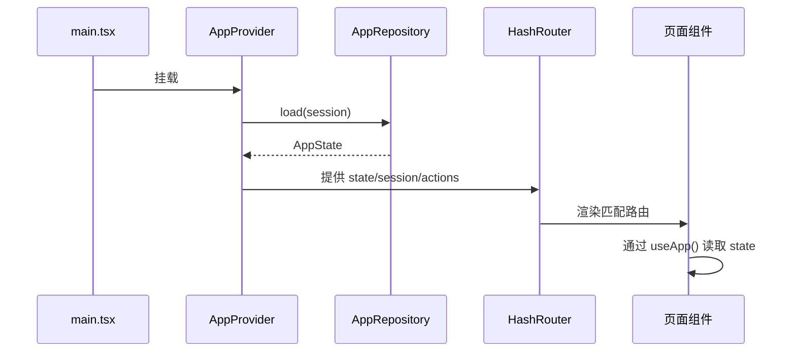
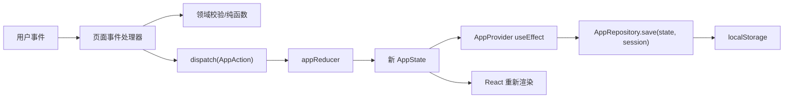

# 数据流

## 读路径

`AppProvider` 初始化时：

1. 用 `SessionRepository.load()` 读取会话（若传入 `initialSession` 则优先）。
2. 校验 account 会话对应的账号是否真实存在；不存在则视为未登录。
3. 用 `AppRepository.load(session)` 得到 state；测试可通过 `initialState` 覆盖。

## 写路径

规则：

- 组件只 `dispatch` 语义化 action；不要在组件里直接改 `state`。
- 需要校验的输入先在事件处理器调用领域函数（如 `isValidCourse`），失败时展示错误，不 dispatch。
- ID（`uid`）、当前时间、文件读取等副作用都在事件处理器/服务中完成；reducer 保持纯函数。
- 每次 state 变化后，Provider 自动保存。保存失败会通过 Toast 提示一次，内存状态仍可用。

## 认证流程

### 注册

1. `register(name)` 校验昵称 2–40 字符。
2. 若 `AppRepository.accountExists(name)` 为真，返回错误。
3. 生成全新 `createSeed()`，写入 session 与该账号快照。
4. 路由跳转到首页。

### 登录

1. 校验昵称格式。
2. 必须存在对应账号快照，否则返回“找不到该演示账号”。
3. 设置 session，读取该账号快照替换全局 state。

### 访客

设置 `{ mode: 'guest' }`，读取全局快照。访客与账号共享全局键，因此会看到最近一次保存的演示数据。

### 退出

先保存当前 state，再清空 session，最后将内存 state 重置为种子；账号快照保留，可再次用同一昵称登录。

## 持久化键

| 键                                | 位置           | 用途                   |
| --------------------------------- | -------------- | ---------------------- |
| `campus-life-demo:v2`             | localStorage   | 全局最新状态。         |
| `campus-life-demo-account:<name>` | localStorage   | 按昵称隔离的账号快照。 |
| `campus-life-demo-session-v2`     | sessionStorage | JSON 会话。            |
| `campus-life-demo-v1`             | localStorage   | 旧版状态，只读迁移。   |
| `campus-life-demo-session`        | sessionStorage | 旧版会话，只读迁移。   |

## 失败处理

- `localStorage` 不可用/配额满：`save()` 返回 `{ ok: false, reason }`；Provider 首次失败时提示，后续静默。
- `sessionStorage` 不可用：会话只存在内存中，刷新后需重新进入。
- 媒体 API 不可用：录音按钮禁用；`startMicrophoneRecording()` 抛出可读错误，由页面转成提示。
- 图片压缩失败：不发送消息，提示重试。
