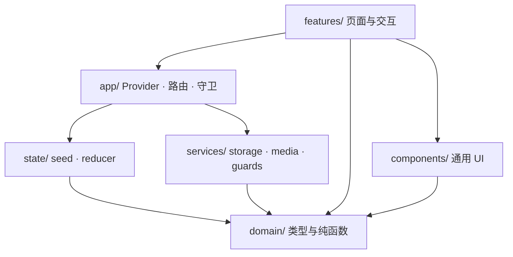

# 架构总览

## 目标

同频是一个**纯前端、本地优先**的校园生活演示应用。工程目标是：

- 业务规则与 React 解耦，可单测；
- 状态变更集中、可追踪；
- 存储与浏览器 API 可替换，测试无需真实 `localStorage`；
- 功能按领域切分，新增页面不复制状态逻辑；
- 演示边界清晰，不伪装真实认证、联网或地图能力。

## 分层与依赖方向



依赖只能向下：`domain` 不依赖 React、浏览器存储或任何上层模块。`state` 只依赖 `domain`。`services` 可依赖 `domain`，但不得 import `features`。页面通过 `useApp()` 访问状态，不直接读 `localStorage`。

## 运行时组成

| 层     | 目录              | 职责                                                                         |
| ------ | ----------------- | ---------------------------------------------------------------------------- |
| 领域层 | `src/domain/`     | 类型、校验、排序、匹配、聊天限制、论坛规则、日期工具。全部为纯函数。         |
| 状态层 | `src/state/`      | `createSeed()` 初始数据、`appReducer()` 纯 reducer。                         |
| 服务层 | `src/services/`   | `AppRepository` / `SessionRepository` 持久化边界，媒体处理，运行时类型守卫。 |
| 应用层 | `src/app/`        | `AppProvider` 组合状态、鉴权、自动保存；路由常量与鉴权守卫。                 |
| 视图层 | `src/components/` | Shell、Dialog、Toast、表单控件、图标、头像等无业务组件。                     |
| 功能层 | `src/features/`   | 每个业务域的页面、对话框与局部交互。                                         |
| 样式层 | `src/styles/`     | 设计令牌、基础样式、布局、按功能拆分的 CSS。                                 |

## 组合根

`src/main.tsx` 是唯一组合根：

```tsx
<StrictMode>
  <ToastProvider>
    <AppProvider>
      <HashRouter>
        <App />
      </HashRouter>
    </AppProvider>
  </ToastProvider>
</StrictMode>
```

顺序有意义：`AppProvider` 在持久化失败时需要 `useToast()`，因此必须位于 `ToastProvider` 内。路由必须在 Provider 内，页面才能使用 `useApp()`。

## 关键不变量

1. 页面不直接读写 `localStorage`/`sessionStorage`；只经 `AppRepository` 与 `SessionRepository`。
2. reducer 必须是纯函数，不调用 `Date.now()`、`Math.random()`、`crypto`；ID 与时间在事件处理器中生成。
3. 所有持久化文本经 React 自动转义；禁止 `dangerouslySetInnerHTML`。
4. 演示账号不收集密码；任何 `type="password"` 都视为回归。
5. 课表默认私密；匹配必须双方主动开启且同院系。
6. 聊天附件有明确上限：图片 ≤ 8MB、语音 ≤ 20 秒、文本 ≤ 2000 字。
7. 地图不得展示虚构坐标或路线。

## 非目标

- 服务端、数据库、真实鉴权、推送通知、实时聊天、地图 SDK。
- 多设备同步、离线 Service Worker、国际化（当前仅中文）。
- 为未来需求预建抽象；新增抽象必须有当前调用点或测试需求。
